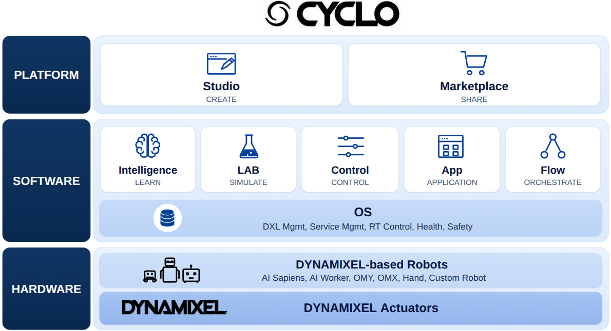
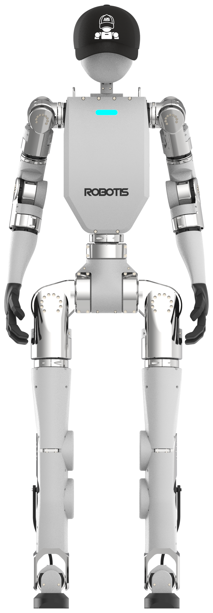
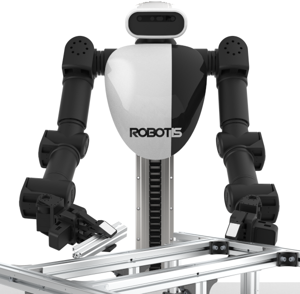
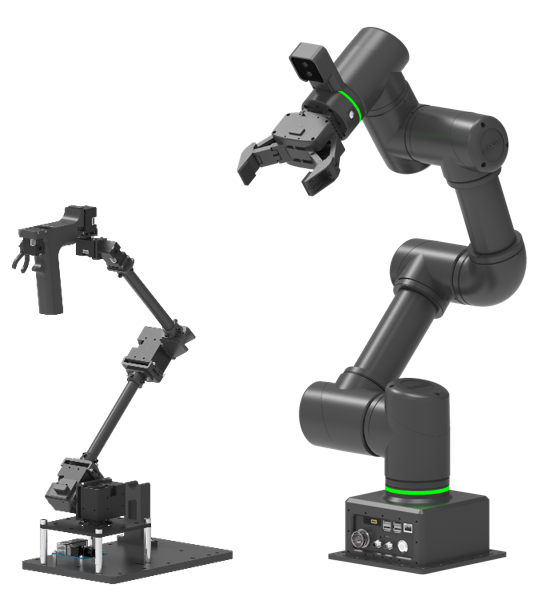
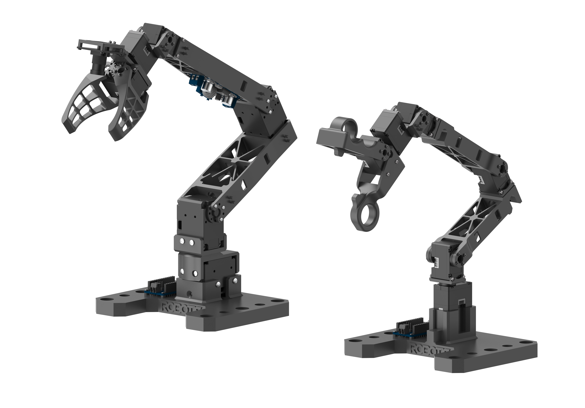
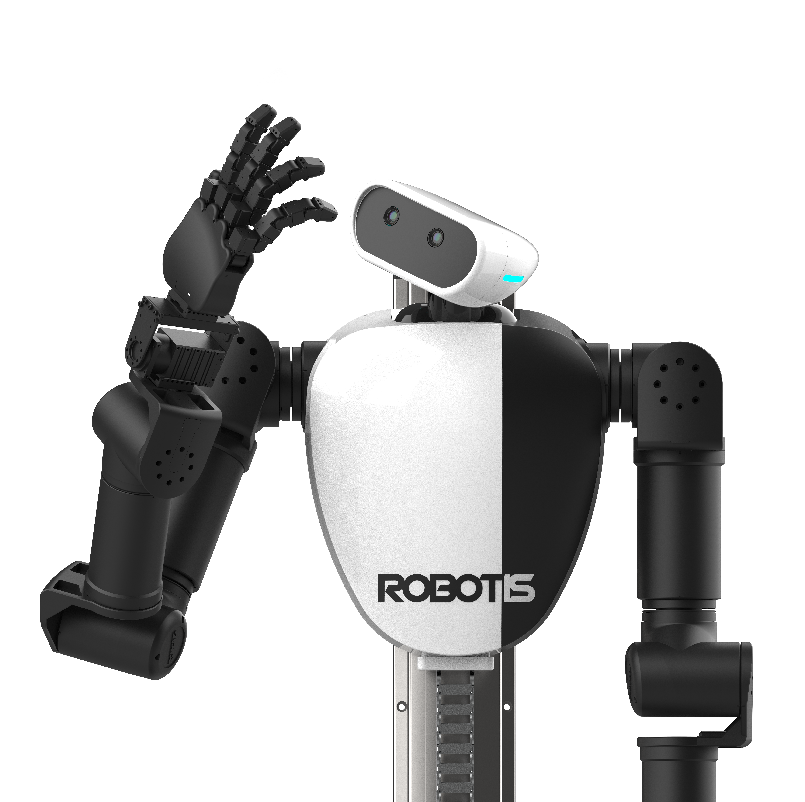
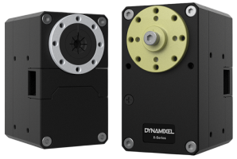

# CYCLO

<strong>Physical AI ecosystem · ROBOTIS</strong>

  
  

**CYCLO** is ROBOTIS's **Physical AI ecosystem**, connecting the creation and sharing of robot capabilities with learning, simulation, control, applications, and operation on DYNAMIXEL-based hardware.

The architecture is organized into three layers:

- **Platform:** Cyclo Studio simulates and trains Cyclo Ready Robots to create actions and deploy them to physical robots. Cyclo Marketplace lets users share and sell datasets, actions, and AI models.
- **Software:** Intelligence, Lab, Control, App, and Flow cover learning, simulation, motion control, applications, and orchestration. Under these modules, OS provides the common foundation for DYNAMIXEL management, service management, real-time control, health, and safety.
- **Hardware:** DYNAMIXEL actuators power AI Sapiens, AI Worker, OMY, OMX, ROBOTIS Hand, and custom DYNAMIXEL-based robots.

Together, these layers connect robot development with operation: create a workflow, develop learned or simulated behaviors, combine them with motion control and application logic, and run them on the robot. Module availability and setup depend on the robot; the module pages below link to the existing system-specific guides.

CYCLO follows ROBOTIS's open-source philosophy, making software building blocks available for developers to learn from, integrate, and extend.

## Architecture

  

## Modules

| Layer | Module | Role |
| --- | --- | --- |
| Platform | [Cyclo Studio](https://docs.robotis.com/docs/software/cyclo/cyclo_studio) | Simulate and train Cyclo Ready Robots, create actions, and deploy them to physical robots. |
| Platform | [Cyclo Marketplace](https://docs.robotis.com/docs/software/cyclo/cyclo_marketplace) | Share and sell datasets, actions, and AI models. |
| Software | [Cyclo Intelligence](https://docs.robotis.com/docs/software/cyclo/cyclo_intelligence) | Learn through demonstration recording, policy training, and inference. |
| Software | [Cyclo Lab](https://docs.robotis.com/docs/software/cyclo/cyclo_lab) | Simulate robots and develop reinforcement learning policies. |
| Software | [Cyclo Control](https://docs.robotis.com/docs/software/cyclo/cyclo_control) | Generate and execute robot motion. |
| Software | [Cyclo App](https://docs.robotis.com/docs/software/cyclo/cyclo_app) | Provide robot applications. |
| Software | [Cyclo Manager](https://docs.robotis.com/docs/software/cyclo_manager) | Operate and monitor robots through a web UI, including bringup, container management, and software updates. |
| Software | [Cyclo Flow](https://docs.robotis.com/docs/software/cyclo/cyclo_flow) | Orchestrate robot actions and workflows. |
| Software | [Cyclo OS](https://docs.robotis.com/docs/software/cyclo/cyclo_os) | Manage DYNAMIXEL devices, services, real-time control, health, and safety. |

## Cyclo Ready Robot

| [AI Sapiens](https://docs.robotis.com/docs/systems/aisapiens/introduction) | [AI Worker](https://docs.robotis.com/docs/systems/aiworker/introduction) | [OMY](https://docs.robotis.com/docs/systems/omy/introduction) | [OMX](https://docs.robotis.com/docs/systems/omx/introduction) | [ROBOTIS Hand](https://docs.robotis.com/docs/systems/hx5_d20/introduction) | [Powered by DYNAMIXEL](https://docs.robotis.com/docs/dxl/model_reference) |
| :---: | :---: | :---: | :---: | :---: | :---: |
|  |  |  |  |  |  |

## Repositories

The repositories below provide existing CYCLO software and supporting interfaces and integrations. Refer to the module documentation above for each component's place in the architecture and system-specific setup.

| Component | Repository | Role | Release |
|--------|------------|------|---------|
| Cyclo Studio | — | Under development; documentation will be added in a future update. | — |
| Cyclo Intelligence | [`cyclo_intelligence`](https://github.com/ROBOTIS-GIT/cyclo_intelligence) | Next-generation imitation learning workflows |  |
| Cyclo Lab | [`cyclo_lab`](https://github.com/ROBOTIS-GIT/cyclo_lab) | Simulation and Reinforcement Learning |  |
| Cyclo Control | [`cyclo_control`](https://github.com/ROBOTIS-GIT/cyclo_control) | Whole-body control and execution |  |
| Cyclo Manager | [`cyclo_manager`](https://github.com/ROBOTIS-GIT/cyclo_manager) | Operations and system management |  |
| Cyclo OS | — | Under development; documentation will be added in a future update. | — |

## Quick links

| Resource | Description | Link |
|----------|-------------|------|
| Documentation | Product and software manuals | [CYCLO Documentation](https://docs.robotis.com/docs/software/cyclo) |
| Discord | Community chat and support | [ROBOTIS Community](https://discord.gg/robotis) |
| YouTube | Tutorials and demos | [ROBOTIS Open Source Team](https://www.youtube.com/@ROBOTISOpenSourceTeam) |

## Contributing

Contributions are welcome via issues and pull requests in the relevant Cyclo repositories.

## Star History

